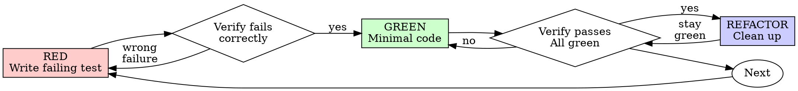

# Test-Driven Development (TDD)

## Signal Sports adaptation (read first; overrides the upstream text below where they differ)

Local adaptation of obra/superpowers `test-driven-development`; provenance in [UPSTREAM.md](UPSTREAM.md).
"Your human partner" below means **Guy**.

**When test-first applies (conditional, not universal)**
- *Applies:* meaningful logic — classification/facts rules, relevance and preference scoring,
  clustering, dedup, ingestion and orchestration, notification planning/dispatch,
  auth/authorization, API behavior and contracts, pure frontend models (`orbit*Model.js`,
  `feedFilters`, `api/normalizers.js`) — and **every reproducible bug**.
- *Does not require a failing automated test first:* documentation and prose, CSS/styling and
  layout tweaks, copy, comments, trivial configuration or version pins, artifacts regenerated by an
  existing script, read-only analysis scripts. Verify those the way `signal-pr-finish` says
  (lint/build, link checks, visual steps).
- *Rule of thumb:* if a plausible future edit could silently break the behavior, it deserves a test.
- Never add tests that mirror the implementation, pin constants or test the framework
  ([writing-good-tests.md](writing-good-tests.md), `signal-pr-open` §6).

**Code written before its test: prove the test, don't delete the work.** Run the new test against
the pre-change behavior (for example `git stash` the fix, or check out the base version of just the
source file), watch it fail for the expected reason, restore, and watch it pass. That red-green
demonstration is what `signal-pr-open` §6 requires; report it. If running against the old behavior
is unsafe or impractical, say so and explain why the test can still fail.

**Where tests go and how to run them.** The area skills name the right test files; see
`python-testing-patterns` for pytest style. Red/green loop: `cd backend; .venv\Scripts\python -m
pytest tests/<file> -q` or `cd frontend; npx vitest run <file>`, then the full suites
(`signal-pr-finish`). The frontend deliberately has no component-testing stack: extract logic into a
pure module and test that (docs/FRONTEND_DESIGN_SYSTEM.md §10, §13). Don't add jsdom or React
Testing Library.

**A green suite is not real-data evidence.** For classification/relevance changes,
`signal-real-data-qa` owns the corpus gate. The examples below are TypeScript; the same discipline
applies to pytest.

---

*Upstream text follows (lightly edited; see UPSTREAM.md).*

## Overview

Write the test first. Watch it fail. Write minimal code to pass.

**Core principle:** If you didn't watch the test fail, you don't know if it tests the right thing.

**Violating the letter of the rules is violating the spirit of the rules.**

## When to Use

See **When test-first applies** in the Signal Sports adaptation above. Inside that scope, don't skip
it "just this once" — that's rationalization.

## The Iron Law

```
NO PRODUCTION CODE WITHOUT A FAILING TEST FIRST
```

Wrote code before the test? Don't delete the work. Prove the test instead: run it against the
pre-change behavior, watch it fail for the expected reason, then restore the change and watch it pass
(see the Signal Sports adaptation above).

## Red-Green-Refactor



### RED - Write Failing Test

Write one minimal test showing what should happen.

<Good>
```typescript
test('retries failed operations 3 times', async () => {
  let attempts = 0;
  const operation = () => {
    attempts++;
    if (attempts < 3) throw new Error('fail');
    return 'success';
  };

  const result = await retryOperation(operation);

  expect(result).toBe('success');
  expect(attempts).toBe(3);
});
```
Clear name, tests real behavior, one thing
</Good>

<Bad>
```typescript
test('retry works', async () => {
  const mock = jest.fn()
    .mockRejectedValueOnce(new Error())
    .mockRejectedValueOnce(new Error())
    .mockResolvedValueOnce('success');
  await retryOperation(mock);
  expect(mock).toHaveBeenCalledTimes(3);
});
```
Vague name, tests mock not code
</Bad>

**Requirements:**
- One behavior
- Clear name
- Real code (no mocks unless unavoidable)

### Verify RED - Watch It Fail

**MANDATORY. Never skip.**

```bash
npm test path/to/test.test.ts
```

Confirm:
- Test fails (not errors)
- Failure message is expected
- Fails because feature missing (not typos)

**Test passes?** You're testing existing behavior. Fix test.

**Test errors?** Fix error, re-run until it fails correctly.

### GREEN - Minimal Code

Write simplest code to pass the test.

<Good>
```typescript
async function retryOperation<T>(fn: () => Promise<T>): Promise<T> {
  for (let i = 0; i < 3; i++) {
    try {
      return await fn();
    } catch (e) {
      if (i === 2) throw e;
    }
  }
  throw new Error('unreachable');
}
```
Just enough to pass
</Good>

<Bad>
```typescript
async function retryOperation<T>(
  fn: () => Promise<T>,
  options?: {
    maxRetries?: number;
    backoff?: 'linear' | 'exponential';
    onRetry?: (attempt: number) => void;
  }
): Promise<T> {
  // YAGNI
}
```
Over-engineered
</Bad>

Don't add features, refactor other code, or "improve" beyond the test.

### Verify GREEN - Watch It Pass

**MANDATORY.**

```bash
npm test path/to/test.test.ts
```

Confirm:
- Test passes
- Other tests still pass
- Output pristine (no errors, warnings)

**Test fails?** Fix code, not test.

**Other tests fail?** Fix now.

**"Other tests" means the project's suite, not just your file.** A
green run of the test you wrote is not a green suite. Before you call
the change done, run the project's test command (bare `pytest`,
`npm test`, `cargo test` — whatever the repo uses) even when your task
named only one test file. A scope statement in your task bounds the
deliverable, not your verification. Any failure that run shows —
including one you didn't cause — goes in your report by name; a red
test you watched scroll past and didn't mention is a report falsified
by omission.

### REFACTOR - Clean Up

After green only:
- Remove duplication
- Improve names
- Extract helpers

Keep tests green. Don't add behavior.

### Repeat

Next failing test for next feature.

## Good Tests

| Quality | Good | Bad |
|---------|------|-----|
| **Minimal** | One thing. "and" in name? Split it. | `test('validates email and domain and whitespace')` |
| **Clear** | Name describes behavior | `test('test1')` |
| **Shows intent** | Demonstrates desired API | Obscures what code should do |

When writing or changing any test, read [writing-good-tests.md](writing-good-tests.md) for the rules that keep tests honest:
- Name the production change that would make the test fail — before writing it
- Assert on real behavior, never on mock behavior
- Keep test-only code in test utilities, out of production classes
- Understand a dependency's side effects before mocking it

## Common Rationalizations

| Excuse | Reality |
|--------|---------|
| "Too simple to test" | Simple code breaks. Test takes 30 seconds. |
| "I'll test after" | Tests written after pass immediately — which proves nothing. They may test the wrong thing, test the implementation instead of the behavior, or miss the edge case you forgot. You never watched it fail, so you never proved it can catch the bug. Test-first forces that failure. |
| "Tests after achieve same goals (spirit not ritual)" | Tests-after answer "what does this do?"; tests-first answer "what should this do?" Tests written after are biased by the code you already wrote — you verify the cases you remembered, not the ones you'd have discovered. Coverage without proof the tests work. |
| "Already manually tested" | Manual testing is ad-hoc: no record of what you covered, no way to re-run it when the code changes, easy to forget cases under pressure. "Worked when I tried it" ≠ comprehensive. Automated tests run the same way every time. |
| "The code already exists, so the test can't fail" | Make it fail: run the test against the pre-change behavior (stash the fix or restore the base version of the source file). A test you never saw fail proves nothing. |
| "I'll write the test to match what the code does" | That mirrors the implementation. Derive the expected values by hand from the requirement, then prove the red step against the old behavior. |
| "Need to explore first" | Fine. Throw away exploration, start with TDD. |
| "Test hard = design unclear" | Listen to test. Hard to test = hard to use. |
| "TDD will slow me down" | TDD IS the pragmatic path: catches bugs before commit, prevents regressions, lets you refactor without fear. "Pragmatic" shortcuts mean debugging in production — slower, not faster. |
| "Manual test faster" | Manual doesn't prove edge cases. You'll re-test every change. |
| "Existing code has no tests" | You're changing it. Add tests for the behavior you change — not for the whole module. |

## Red Flags - STOP

- Code before test
- Test after implementation
- Test passes immediately
- Can't explain why test failed
- Tests added "later"
- Rationalizing "just this once"
- "I already manually tested it"
- "Tests after achieve the same purpose"
- "It's about spirit not ritual"
- Expected values copied from the implementation's output
- "It's already written, so proving the red step is pointless"
- "TDD is dogmatic, I'm being pragmatic"
- "This is different because..."

**All of these mean: stop, and prove a failing test against the pre-change behavior before going further.**

## Example: Bug Fix

**Bug:** Empty email accepted

**RED**
```typescript
test('rejects empty email', async () => {
  const result = await submitForm({ email: '' });
  expect(result.error).toBe('Email required');
});
```

**Verify RED**
```bash
$ npm test
FAIL: expected 'Email required', got undefined
```

**GREEN**
```typescript
function submitForm(data: FormData) {
  if (!data.email?.trim()) {
    return { error: 'Email required' };
  }
  // ...
}
```

**Verify GREEN**
```bash
$ npm test
PASS
```

**REFACTOR**
Extract validation for multiple fields if needed.

## Verification Checklist

Before marking work complete:

- [ ] Every new behavior that matters has a test
- [ ] Watched each test fail before implementing
- [ ] Each test failed for expected reason (feature missing, not typo)
- [ ] Wrote minimal code to pass each test
- [ ] All tests pass
- [ ] Output pristine (no errors, warnings)
- [ ] Tests use real code (mocks only if unavoidable)
- [ ] Edge cases and errors covered

Can't check all boxes? Close the gap (prove the red step against the old behavior) before claiming completion.

## When Stuck

| Problem | Solution |
|---------|----------|
| Don't know how to test | Write wished-for API. Write assertion first. Ask your human partner. |
| Test too complicated | Design too complicated. Simplify interface. |
| Must mock everything | Code too coupled. Use dependency injection. |
| Test setup huge | Extract helpers. Still complex? Simplify design. |

## Debugging Integration

Bug found? Write failing test reproducing it. Follow TDD cycle. Test proves fix and prevents regression.

Never fix bugs without a test.

## Final Rule

```
Production logic in scope → test exists and was seen failing first
Otherwise → not TDD
```

The exemptions are the ones listed in the Signal Sports adaptation; anything else needs Guy's agreement.
