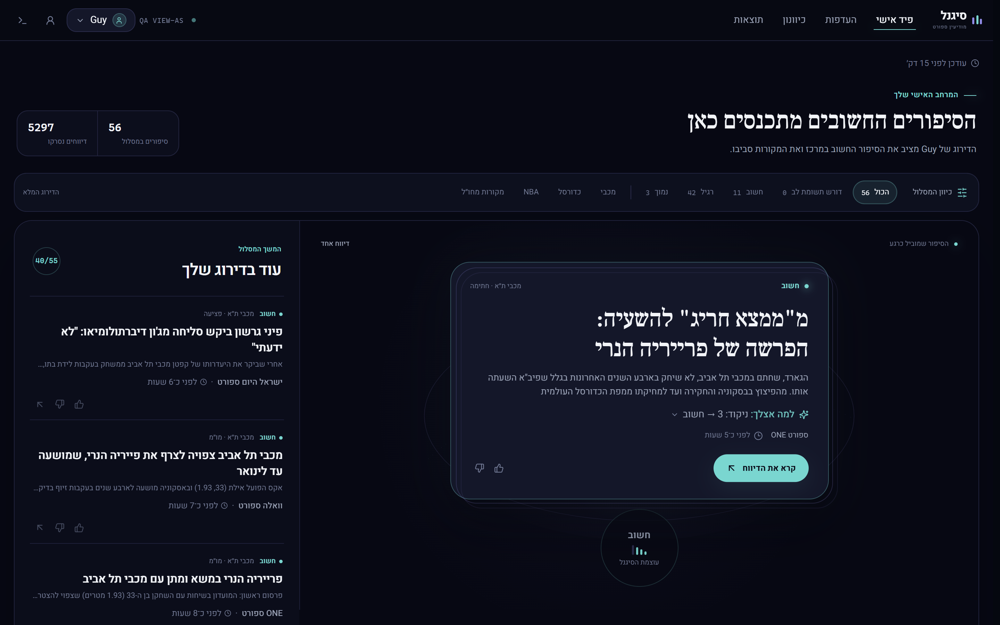
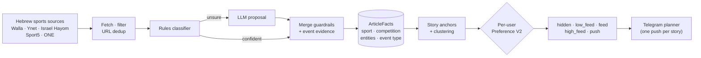
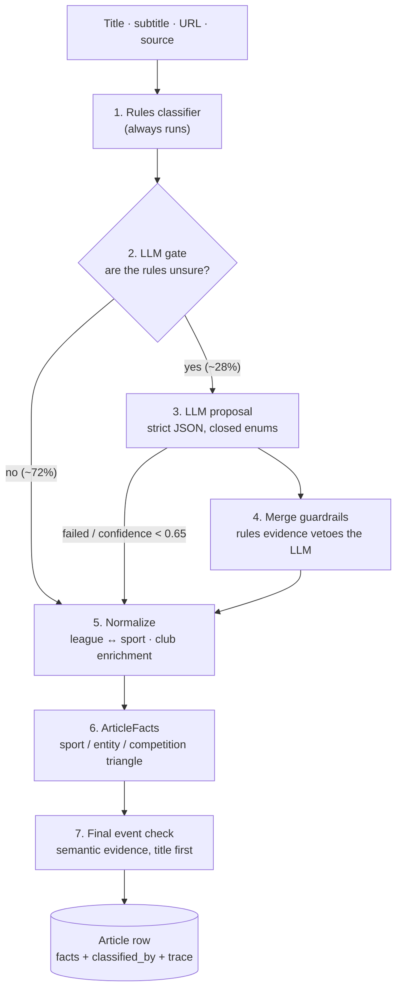
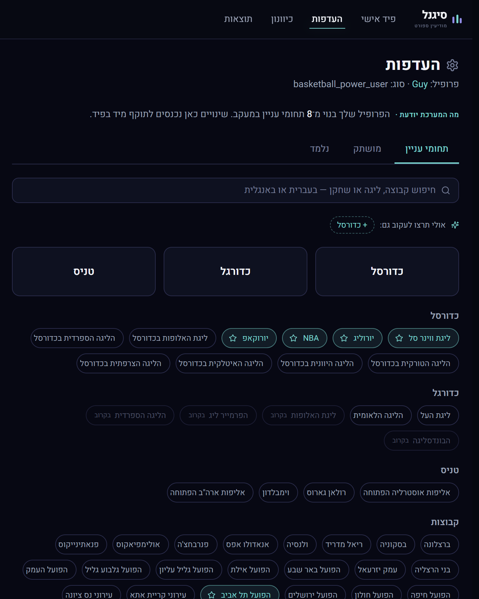
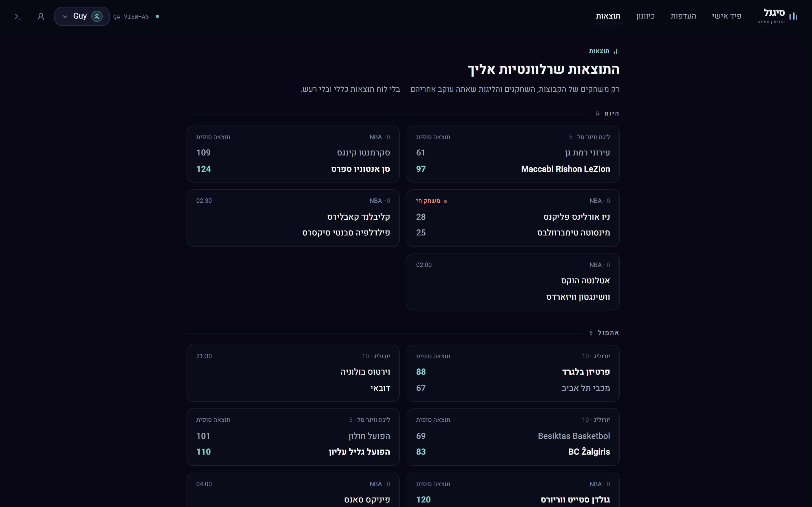
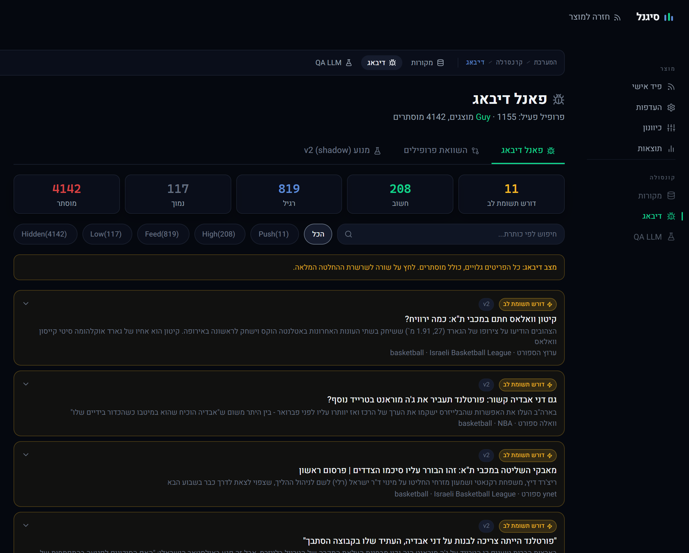
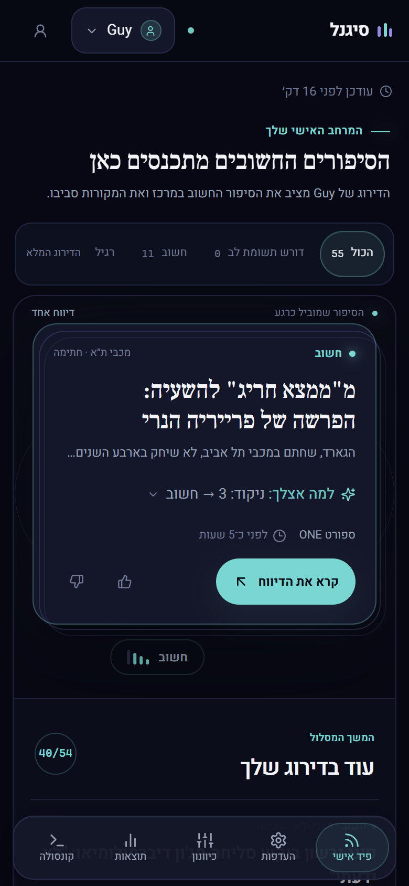

<div align="center">

# 📶 Signal Sports

**A personalized, Hebrew-first sports news intelligence feed.**<br>
Read only the few stories that matter to *you*, without checking seven sports sites.

[](https://github.com/Guy-Navon/signal-sports/actions/workflows/checks.yml)




<sub>The real feed of the `guy` profile on 2026-11-07, built from the live corpus: 56 stories out of
5,297 ingested reports. The leading story is the Pierria Henry suspension saga.</sub>

</div>

---

## Contents

[Why](#why) · [Real examples](#real-examples-one-day-two-readers) · [How it works](#how-it-works) ·
[Engineering](#engineering) · [Quality](#how-quality-is-measured) · [Tech stack](#tech-stack) ·
[Quick start](#quick-start) · [Status](#status-and-limitations) · [Docs](#docs)

## Why

Sports news is noisy. A Maccabi Tel Aviv negotiation can matter more to one reader than a
Champions League result, and a regular-season NBA game can be essential to one fan and pure
noise to another.

Signal Sports answers one question:

> **What sports news is actually worth this user's attention right now?**

It does not try to answer "what sports news exists?". Facts about an article are computed once;
the *decision* is computed separately for every user, so one reader can get a story as `push`
while another never sees it.

| Decision | Meaning |
|---|---|
| `push` | Urgent. Rare by design, and only from an explicit "always notify me" rule |
| `high_feed` | Important for this user |
| `feed` | Normal relevance |
| `low_feed` | Visible, low priority |
| `hidden` | Not in the feed; visible only in the debug view |

## Real examples: one day, two readers

Every headline below is a real article that the worker ingested from Israeli sports sites,
scored by the production engine against two profiles:

- **Guy**, a basketball power user: Maccabi Tel Aviv basketball first, then the EuroLeague, the
  NBA (broadly) and the Israeli league; football and tennis only at low priority.
- **Casual Deni fan**, who follows Deni Avdija and nothing else.

In the 48 hours to the evening of 2026-11-07 the worker stored **338 articles** (173 football,
129 basketball, 14 tennis, 22 with no confidently known sport). **Guy sees 77 of them. The
Deni fan sees 15.** Neither got a push.

| Headline (source) | Facts the classifier extracted | Guy | Deni fan |
|---|---|---|---|
| [רוצה חוזה במאות מיליונים: דני אבדיה קיבל החלטה קריטית](https://www.israelhayom.co.il/sport/world-basketball/article/21797172) (Israel Hayom) | basketball · NBA · Deni Avdija · `news` | `high_feed` | `high_feed` |
| [אבדיה אמר לברוקס בעימות: אני יותר טוב ממך](https://www.one.co.il/Article/538119.html) (ONE) | basketball · NBA · Deni Avdija · `news` | `feed` | `high_feed` |
| [פרייריה הנרי במשא ומתן עם מכבי תל אביב](https://www.one.co.il/Article/538226.html) (ONE) | basketball · Israeli league · Maccabi TLV · `negotiation` | `high_feed` | `hidden` |
| [מכה למכבי תל אביב: איפה לונדברג ייעדר לכשלושה חודשים](https://www.israelhayom.co.il/sport/israeli-basketball/article/21796201) (Israel Hayom) | basketball · Israeli league · Maccabi TLV · `injury` | `high_feed` | `hidden` |
| [30 נקודות לבוקר ו-24 לברוקס בניצחון של פיניקס](https://www.one.co.il/Article/538106.html) (ONE, also Ynet) | basketball · NBA · Phoenix Suns · `match_result` | `feed` | `hidden` |
| [רבע 1, 07:19: הפועל חולון - גליל עליון 4:6](https://www.one.co.il/Article/538126.html) (ONE) | basketball · Israeli league · two clubs · live score | `low_feed` | `hidden` |
| [מאור לוי יחזור להרכב, אבוחצירה כשיר למכבי חיפה](https://www.one.co.il/Article/538103.html) (ONE) | football · Israeli Premier League · lineup news | `hidden` | `hidden` |

What the table shows:

- **The same article gets different decisions.** A regular-season Phoenix win is normal feed for
  someone who follows the whole NBA and noise for someone who follows one player.
- **The Deni fan rates Deni higher than Guy does.** For Guy, Deni is one interest among many. For
  the fan, he is the only one.
- **Injuries are important, not urgent.** The Lundberg injury is `high_feed`, not `push`. That is an
  explicit product rule: an injury never triggers a push.
- **Live-score ticks are kept but pushed down** (`low_feed`), and pre-match lineup items for a
  sport Guy follows at low priority disappear.

Each visible card carries a Hebrew "why" line built from the actual contribution path, for
example *"מכבי תל אביב (כדורסל) ברשימת המעקב שלך"* or *"פיניקס סאנס משחקת ב-NBA, שברשימת המעקב שלך"*.

### A real push

Push is reserved for a few explicit rules. On 2026-07-22, Sport5 published
[**"איפה לונדברג סיכם על חוזה חדש במכבי תל אביב"**](https://www.sport5.co.il/articles.aspx?FolderID=274&docID=554077).
Guy's profile has an `always_push` rule for Maccabi negotiations, and the headline states a
completed agreement. So it scored `push` for Guy, and the Telegram pilot sent it to his phone.
For the Deni fan it was `hidden`. Two days later Israel Hayom reported
["דיווח: לוני ווקר במו"מ עם קבוצה ענקית מהיורוליג"](https://www.israelhayom.co.il/sport/world-basketball/article/21050541),
also a Maccabi negotiation, and it stayed at `high_feed`: a negotiation that is only *in progress*
does not pass the severity gate.

### A real cluster, and a real miss

Three outlets reported the Pierria Henry move on 2026-11-07. Walla's
["מכבי תל אביב צפויה לצרף את פייריה הנרי"](https://sports.walla.co.il/item/3875306) and Ynet's
["פייריה הנרי סיכם וינחת בישראל בשבוע הבא"](https://www.ynet.co.il/sport/israelibasketball/article/hkoa5nntzl)
were grouped into one story. Guy still sees only the Walla report. Ynet's headline never names
Maccabi, and Henry is not in the taxonomy, so that report has no entity and is `hidden` for Guy.
Clustering never shows a hidden member, so the more advanced fact ("agreed") never reached him.

That is the main weakness today: **recall on stories that name no registered team or person.**
In the October census, 71 of 76 wrongly hidden stories had no competition, and 34 had no entity.

## How it works



1. **Ingest.** A background worker pulls five Hebrew sources every 5 minutes.
2. **Understand.** Every article becomes user-independent *facts*. The classifier abstains when
   it is unsure, because a false fact is worse than a missing one.
3. **Group.** Reports about the same story collapse into one card, listing all its sources.
4. **Decide per user.** Each user's preference profile turns the facts into one of five
   decisions, with an explanation.

## Engineering

### Runtime topology

```
Phone ──Tailscale Serve (HTTPS)──┐
Desktop browser ─────────────────┤
                                 ▼
          Vite :5173  (React app; proxies /api)
                                 ▼
          API   uvicorn app.main:app :8000      serves requests, never schedules
                                 │
                 SQLite (WAL)  backend/data/signal_sports.db
                                 │
          Worker  python -m app.worker          5-min cycles behind a durable lease
                                 │
          LLM (OpenAI-compatible or Ollama)   TheSportsDB   Telegram Bot API
```

The API and the worker are separate processes sharing one SQLite file in WAL mode. The worker
takes a **single-flight lease** row before each cycle, so a restart or a second worker cannot run
overlapping cycles. A heartbeat row (`worker_status`) shows whether the worker is alive.

### One ingestion cycle

`app/ingestion/orchestration.py::orchestrate_cycle`:

1. acquire the lease;
2. for each enabled source: fetch (RSS via `feedparser`, HTML via `httpx` + BeautifulSoup, ONE
   via its public JSON) → sport-section filter → URL dedup → classify → insert;
3. compute story anchors and update clusters;
4. plan notifications per story, then dispatch them through an outbox;
5. sync game results for followed teams (TheSportsDB, throttled);
6. release the lease and record the run, with per-source metrics and failure reasons.

A failed source degrades the cycle instead of failing it. A source that returns nothing is a
success, not an error.

### Classification: rules first, LLM second, guardrails always

Classification answers one question, *what is this article about?*, once per article and for no
particular user. It never looks at a profile, and a relevance change never needs re-classification.
The whole process runs per article inside `_normalise` in `app/ingestion/ingestion_service.py`.
The principle at every stage: **when the evidence is not there, abstain** (`sport=unknown`, no
entity, `event_type=news`). A wrong fact reaches the feed as truth; a missing one only costs recall.



**Input.** The Hebrew title is the primary signal. The subtitle (the RSS summary) only fills gaps
and never overrides the title. The URL is used for league hints (`/eurocup/`), and for Israel Hayom
its section path (`/sport/israeli-basketball/`) gives a near-authoritative *source sport hint*
(`classification/source_hints.py`).

**1. Rules classifier** (`ingestion/classifier.py::classify`). Deterministic, free and testable,
and it runs on every article, also as the fallback and the guardrail source for the LLM:

- **Sport**: the source hint, then sport keywords; then a named club person ("a player of X"
  proves the sport); then entities that all agree on one sport.
- **Entities**: aliases from the taxonomy. A cross-sport club name with no sport evidence
  (`מכבי תל אביב`, `הפועל ירושלים`) resolves to *no* entity and gets the `ambiguous_club` tag.
  Bare `מכבי` or `הפועל` never resolve.
- **Subtitle gap-filling**: only when the title left the sport unknown or found no entity. A
  person named only in the subtitle proves the sport but does not make the article about their club.
- **League**: an explicit competition keyword, a few entity rules (Deni Avdija → NBA; a WNBA story
  is never NBA), then a membership-derived league that is kept for display only.
- **Event type** (`classification/event_evidence.py`): keyword evidence with a certainty
  (`confirmed`, `probable`, `weak`). Then importance, confidence and tags are derived from the result.

**2. LLM gate** (`classification/gating.py`). Only for the five Hebrew broad sources, only when a
provider is configured, and only while the per-run circuit breaker is closed. It *forces* a call for
`ambiguous_club`, unknown sport, or rules confidence below 0.55. It *skips* when a clear league
keyword matches a resolved league, when a source hint agrees and there is already context, when
the result is strong (league plus confidence ≥ 0.80, or entity plus a specific event plus
confidence ≥ 0.75), and for generic `news` (a probe showed the LLM changed 0 of 16 of those).
Every decision records its reason. About 28% of eligible articles reach the LLM.

**3. LLM proposal** (`classification/prompt.py`, `providers.py`). Title and subtitle go in; a
strict JSON object comes out, with closed enums for sport, league and event type, at temperature 0.
The prompt says to answer `unknown` rather than guess, and never to judge whether a user should see
the article. Providers are pluggable: `openai_compat` (currently `gpt-oss-20b` on Groq, an interim
choice after a [bake-off](docs/qa/LLM_BAKEOFF_2026-10-25.md)), Ollama, Gemini, or `disabled`. A
failure (timeout, HTTP error, unparseable JSON) keeps the rules result as
`rules_fallback_after_llm_failure`, and a confidence below 0.65 keeps it as
`rules_fallback_low_confidence`. Failures are typed and counted per run.

**4. Merge guardrails** (`classification/merge.py`). The LLM *proposes*; it wins by default
except where deterministic evidence says otherwise:

| Guardrail | Rule |
|---|---|
| 0 | Unsupported sport (MMA, UFC, boxing) → `unknown`, whatever the LLM said |
| 1 · 1b | A football Maccabi club, or unambiguous single-sport vocabulary, beats a contradicting LLM sport |
| 2 · 3 | The LLM said `unknown` sport or no league, and the rules found one → the rules value |
| 4 | The rules found a specific event and the LLM said `news` → the rules event |
| 4b | Every LLM event type needs semantic evidence in the text, or it falls back to the rules event or `news` (and a rejected championship loses its `very_high`) |
| 5 | Importance is never lowered below the rules' importance |
| 6 | A league forces its sport (EuroLeague → basketball) |
| 7 | The source URL hint fills the sport, but never overrides committed contradicting vocabulary |

Entities are then the rules' entities pruned to the final sport, plus LLM entities that normalize
to a known canonical name. The row is marked `llm` or `llm+rules_guardrail`.

**5. Normalize.** One league/sport compatibility pass for both paths, so no row can store an
impossible pair. When the final sport is basketball, an Israeli club the title names in full (the
`ambiguous_club` case) is added as an entity.

**6. ArticleFacts** (`classification/facts.py::build_article_facts`). The authority on what is
stored. It scans explicit competition evidence in the title and subtitle (never the URL: short
tokens like `nba` false-match slugs), resolves the sport by an evidence-weight order in which
explicit evidence can override a weaker incoming sport, and drops entities of the wrong sport. A
cross-sport club that came from the LLM or from enrichment, not from the text, survives only with
explicit sport evidence (or, for basketball, a deterministic cue the LLM did not produce): an LLM
sport guess must not be laundered into a trusted fact. It derives `primary_competition` (explicit
evidence only), canonical `entity_ids`, and records every conflict in the trace.

**7. Final event check** (`_apply_post_facts_event_validation`). The event is re-validated against
the final sport. Evidence found only in the subtitle caps certainty at `probable`. Title-local
events (`title_win`, `grand_slam_winner`, `major_trade`, `schedule`) with no evidence in the title
become `news`, because a championship word in a subtitle is almost always an epithet for someone
else. A championship that is not confirmed loses `very_high`. A `news` row stores *why* it abstained.

**Output.** The `Article` row holds the facts (sport, league, competitions, entity ids, event type
and certainty, importance), `classified_by` (`rules`, `llm`, `llm+rules_guardrail` or a
`rules_fallback_*` value), the LLM's provider, confidence and one-line reason, the taxonomy version,
and a full `classification_trace` of every stage, which the debug panel shows. Stored facts change
afterwards only through reviewed, backed-up correction scripts, after an in-memory rerun diff of the
whole corpus. Full contracts: [ARTICLE_FACTS](docs/ARTICLE_FACTS.md),
[LLM_CLASSIFICATION](docs/LLM_CLASSIFICATION.md), [RSS_QUALITY_GUARDRAILS](docs/RSS_QUALITY_GUARDRAILS.md).

Of the 5,297 stored articles, 63% were classified by rules alone and 18% with the LLM involved.
Another 18% fell back to rules after an LLM failure, most of them during a local-model timeout
period in October; each run counts these so an outage's cost is visible.

**Taxonomy** (`app/taxonomy/`) is the single source of entity truth: 117 entities (79 teams,
31 players, 2 coaches, 5 executives) and 22 competitions. Bare family names like `מכבי` or `הפועל`
never resolve to a club on their own.

### Relevance: Preference V2

A profile (`ProfileV2`) holds three kinds of things:

- **Scope affinities**: sport, competition, team, player or coach, each at a level from −2 to +2,
  tagged with where it came from (explicit, calibration or learned).
- **Event affinities**: deltas for event types, global or scoped (for example *Maccabi × candidate −1*).
- **Overrides**: `always_push`, `never_show` and mute.

Scoring an article:

1. **Visibility.** Does any followed scope match? Matching runs in four tiers: explicit
   competition, legacy league, participant-set inference, then team-membership reach (capped at
   `feed`). If nothing matches, the article is `hidden`.
2. **Affinity layers.** Add the matched scope and event affinities. For the same target, explicit
   beats learned beats calibration, and a scoped entry beats a global one.
3. **Learned adjustments** from feedback. These activate after 3 or more consistent events, are
   capped at ±1, decay with a 90-day half-life, never create an exclusion, and are derived at read
   time rather than written into the profile.
4. **Overrides.** `never_show` hides. `always_push` can raise a story to `push`, but only behind a
   **factual severity gate**: a completed agreement, an imminent renewal or a concrete governance
   step, with the followed scope as the subject of the headline. A boost or a high importance on
   its own never produces a push.

Profiles are populated in three ways: picking interests from the taxonomy catalog, calibration
on 77 synthetic headlines, and feedback ("more / less like this").

### Clustering

Clustering is deterministic, with no embeddings and no LLM. Candidates within a time window are
compared through validated story anchors (subject, transaction verb, event state), Hebrew
transliteration skeletons and claim compatibility. A shared name is necessary but never enough on
its own. On top of that:

- one slot per source per story;
- `analysis` and `interview` are never clustered;
- clustering never changes an article's score. Collapse happens *after* per-user scoring: a card's
  decision is the highest decision among the members **that user can see**, and hidden members
  never appear.

Notifications are planned per story lineage, so one story produces at most one push even when
five outlets report it.

### Persistence and safety

- **SQLite + SQLAlchemy 2.0**, 29 tables, additive soft migrations at startup that fail loudly.
  Postgres exists only as CI-rehearsed groundwork.
- **The corpus is evidence.** It holds the article ids of every human rating, so code guards
  refuse resets, and stored facts change only through reviewed, backed-up correction scripts
  (`backend/scripts/apply_*.py`). There is never a blanket re-classification.
- **Auth:** Argon2 passwords, HttpOnly cookie sessions, origin and fetch-metadata CSRF checks, email
  verification, Google sign-in, fail-closed admin routers. `DEPLOY_ENV=hosted` refuses dangerous
  dev flags at startup.

### Code and tests

| | |
|---|---|
| Backend | ~31k lines of Python in `backend/app/`, **4,048 pytest tests** |
| Frontend | ~16k lines in `frontend/src/`, ~620 Vitest tests, ESLint + TypeScript checks |
| CI | `checks.yml` (backend + frontend on every PR) · `images.yml` (Docker images, compose smoke test, backup/restore, deploy and Postgres rehearsals) · `devcontainer.yml` · `lock-refresh.yml` (hash-pinned `requirements.lock`) · `publish-images.yml` |

### Design decisions

| Decision | Why |
|---|---|
| Rules before the LLM | Deterministic, testable, free and fast. The LLM covers the uncertain minority and can be switched off |
| Abstain rather than guess | A wrong fact reaches the feed as truth. A missing fact only costs recall, which is measured |
| Facts separate from decisions | One classification serves every user, and a relevance change never needs re-classification |
| Push only from explicit rules | Push loses its meaning if a score can trigger it. Guy's profile has 6 `always_push` rules in total |
| No embeddings for clustering | Every merge is explainable, and a wrong merge can be traced to one anchor |
| SQLite | One machine, one writer process, WAL for concurrent reads. Postgres is prepared for hosting |

## How quality is measured

Unit tests prove the engine does what it was told. **Owner ratings** prove whether it was told the
right thing:

- **Census gate.** 804 articles, each rated by the owner. The engine must not regress. Current
  baseline for Guy: shown precision 95.9%, feed-or-higher recall 73.9%. The Deni profile must not
  drift.
- **N05 gate.** 282 ratings on a frozen July corpus: Guy shown precision 98.3%, push 7/7.
- **Census #3.** 300 articles from November, rated blind, with a sealed held-out half.
- Rerun diffs of the whole corpus, in memory, before any classifier change.

Precision and recall are always read separately, never as one accuracy number. One-notch
disagreements are treated as rating noise.

## Tech stack

| Layer | Technology |
|---|---|
| Frontend | React 18, Vite 6, Tailwind, TanStack Query, framer-motion. Hebrew/RTL UI with a separate ops console |
| Backend | FastAPI, Python 3.13, SQLAlchemy 2.0 on SQLite (WAL) |
| Worker | Scheduled ingestion cycles behind a single-flight lease |
| Classification | Rules first, then an optional LLM (an OpenAI-compatible API or local Ollama) behind guardrails |
| Results | TheSportsDB |
| Push | Telegram Bot API |
| Packaging | Docker images and Compose for hosting (CI-rehearsed, not deployed) |

## What's inside

<table>
<tr>
<td width="50%" valign="top">

### 🎯 Preferences that mean something
Not just on/off toggles: *"NBA: everything"*, *"Tennis: only Grand Slam winners"*,
*"Football: only major transfers"*, plus followed players and teams.



</td>
<td width="50%" valign="top">

### 🏀 Results that are about you
Only games of the teams and leagues you follow, with no general scoreboard.



</td>
</tr>
<tr>
<td width="62%" valign="top">

### 🔍 A debug panel that explains every decision
Every article, including the hidden ones, with the full decision path, so a wrong decision is
easy to spot.



</td>
<td width="38%" valign="top">

### 📱 Built for the phone
The same feed at a 390 px phone width. The owner opens it over Tailscale.



</td>
</tr>
</table>

All screenshots show real data. They were taken on 2026-11-07 from a read-only snapshot of the live
database.

**Also:** onboarding (interest picker plus calibration), feedback learning, a private Telegram push
pilot, accounts with email verification and Google sign-in, and an ops console for sources,
ingestion runs, LLM QA and profile comparison.

## Repository structure

```
signal-sports/
├── frontend/        React + Vite + Tailwind (Hebrew/RTL product UI + ops console)
├── backend/
│   ├── app/
│   │   ├── ingestion/       sources, adapters, rules classifier, cycle orchestration
│   │   ├── classification/  LLM gate, providers, merge guardrails, ArticleFacts, event evidence
│   │   ├── taxonomy/        entities and competitions (the single source of truth)
│   │   ├── services/        Preference V2 engine, feed, learning, calibration, auth
│   │   ├── clustering/      deterministic story clustering
│   │   ├── notifications/   planner, outbox, dispatcher, Telegram
│   │   ├── results/         TheSportsDB sync
│   │   ├── qa/              gate logic shared by CI and the local corpus tools
│   │   └── worker.py        the scheduler process
│   ├── scripts/     corpus tools: gates, census, rerun diff, reviewed correction scripts
│   └── tests/
├── deploy/          hosted-stack Compose, deploy/backup/restore scripts (CI-rehearsed)
├── scripts/         worker.ps1 (start/stop/status), check.ps1
├── docs/            contracts, current state, QA evidence
└── .claude/skills/  Claude Code project workflows
```

## Quick start

```powershell
# backend (from backend/)
python -m venv .venv
.venv\Scripts\python -m pip install --require-hashes -r requirements.lock
.venv\Scripts\python -m uvicorn app.main:app --reload        # http://127.0.0.1:8000/docs

# scheduler worker (from the repo root; needs SCHEDULER_ENABLED=true in backend/.env)
powershell -File scripts\worker.ps1            # starts it; -Status / -Stop

# frontend (from frontend/)
npm install
npm run dev                                                 # http://localhost:5173
```

> **Tip:** `VITE_DATA_MODE=local` runs the frontend on bundled sample data without a backend.
> `VITE_DATA_MODE=backend` (in `frontend/.env.local`) uses the real API.

**Checks** (the same as CI): `powershell -File scripts\check.ps1` (`-Backend` or `-Frontend` for
one side), or `cd backend; .venv\Scripts\python -m pytest tests -q` and
`cd frontend; npm run lint; npm run typecheck; npm run test; npm run build`.
Details: [backend/README.md](backend/README.md), [frontend/README.md](frontend/README.md).

## Status and limitations

- **Runs on the owner's Windows PC.** The worker is live and ingests every 5 minutes. Moving to a
  host is the top priority: the repository side is ready and CI-rehearsed
  ([DEPLOYMENT.md](docs/DEPLOYMENT.md)), and the host choice is open
  ([HOSTING_PLAN.md](docs/HOSTING_PLAN.md)).
- **The hosted beta will be private.** Sign-up will need the owner's approval.
- **Telegram push is off** since 2026-09-13. The last real push was on 2026-07-24.
- **Real usage is close to zero**, so the feedback-learning loop has never run on real usage.
- **Recall gap:** stories that name no registered team or person are often hidden. Outside
  Maccabi and Hapoel Tel Aviv, Israeli-league players and coaches are not in the taxonomy yet.
- **Hebrew only.** English sources (Eurohoops, Sportando) and title translation are post-MVP.

## Docs

Start here (cold start, no history needed):

- [docs/CURRENT_PROJECT_STATE.md](docs/CURRENT_PROJECT_STATE.md): **the authoritative current
  state**. Architecture, open work, how to run, a handoff prompt and a doc map.
- [docs/RELEVANCE_CONTRACT.md](docs/RELEVANCE_CONTRACT.md): the umbrella contract (pipeline map,
  decision semantics, architecture invariants, quality gate).
- [CLAUDE.md](CLAUDE.md) and [docs/PRODUCT_UNDERSTANDING.md](docs/PRODUCT_UNDERSTANDING.md):
  product intent and vision.

<details>
<summary><b>Layer contracts</b></summary>

[ARTICLE_FACTS](docs/ARTICLE_FACTS.md) ·
[RELEVANCE_VISIBILITY_CONTRACT](docs/RELEVANCE_VISIBILITY_CONTRACT.md) ·
[PREFERENCE_MODEL_V2](docs/PREFERENCE_MODEL_V2.md) · [INTERESTS](docs/INTERESTS.md) ·
[CALIBRATION_V2](docs/CALIBRATION_V2.md) · [FEEDBACK_LEARNING](docs/FEEDBACK_LEARNING.md) ·
[TAXONOMY](docs/TAXONOMY.md) · [LLM_CLASSIFICATION](docs/LLM_CLASSIFICATION.md) ·
[RSS_QUALITY_GUARDRAILS](docs/RSS_QUALITY_GUARDRAILS.md) · [RSS_INGESTION](docs/RSS_INGESTION.md) ·
[CLUSTERING](docs/CLUSTERING.md) · [FEED_FRESHNESS](docs/FEED_FRESHNESS.md) ·
[SCHEDULER](docs/SCHEDULER.md) · [NOTIFICATIONS](docs/NOTIFICATIONS.md) ·
[RESULTS](docs/RESULTS.md) · [USER_PLATFORM](docs/USER_PLATFORM.md) ·
[FRONTEND_DESIGN_SYSTEM](docs/FRONTEND_DESIGN_SYSTEM.md) ·
[MOBILE_REMOTE_ACCESS](docs/MOBILE_REMOTE_ACCESS.md) · [DEPLOYMENT](docs/DEPLOYMENT.md) ·
[HOSTING_PLAN](docs/HOSTING_PLAN.md) · [TITLE_TRANSLATION](docs/TITLE_TRANSLATION.md) (post-MVP)

</details>

**Evidence:** [docs/qa/](docs/qa/) holds the census and N05 ground truth, gate baselines and their
data files. [docs/audits/2026-09-05.md](docs/audits/2026-09-05.md) is the September repository
audit snapshot.

---

<div align="center">
<sub>Security reports: see <a href="SECURITY.md">SECURITY.md</a>.</sub>
</div>
