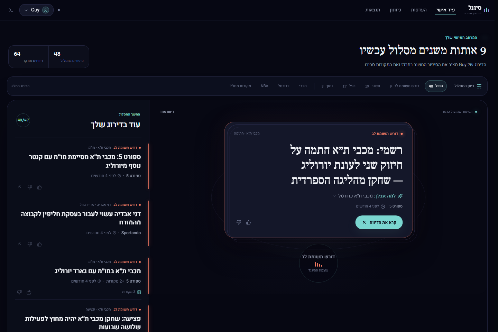
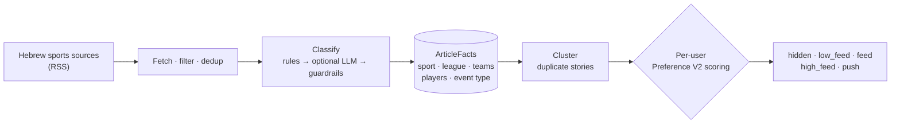
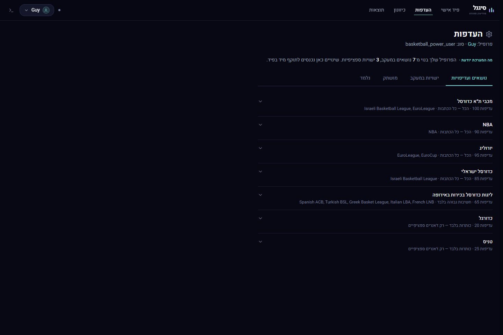
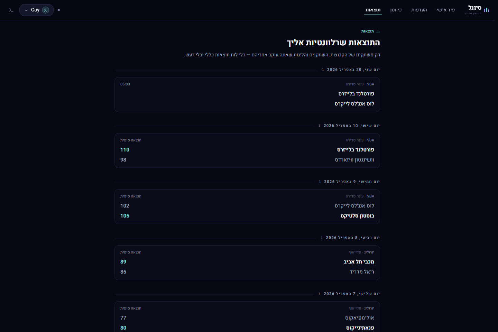
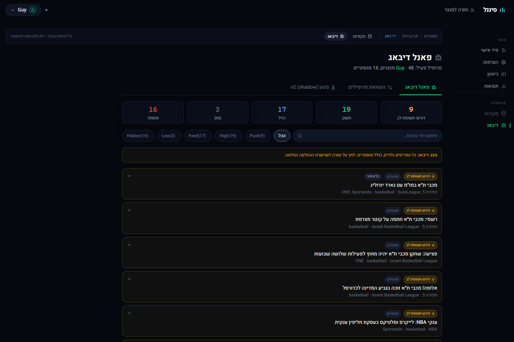

<div align="center">

# 📶 Signal Sports

**A personalized, Hebrew-first sports news intelligence feed.**<br>
Read only the few stories that matter to *you*, without checking seven sports sites.

[](https://github.com/Guy-Navon/signal-sports/actions/workflows/checks.yml)




</div>

---

## Why

Sports news is noisy. A Maccabi Tel Aviv negotiation can matter more to one reader than a
Champions League result, and a regular-season NBA game can be essential to one fan and pure
noise to another.

Signal Sports answers one question:

> **What sports news is actually worth this user's attention right now?**

It does not try to answer "what sports news exists?". The same article is scored separately
for every user, so one reader can get it as `push` while another never sees it.

## How it works



1. **Ingest.** A background worker pulls Hebrew sports sources every few minutes.
2. **Understand.** Every article becomes user-independent *facts*: sport, competition, teams,
   players, event type and importance. The classifier abstains when it is unsure, because a
   false fact is worse than a missing one.
3. **Group.** Articles about the same story collapse into one card, with all its sources.
4. **Decide per user.** Each user's preference profile turns the facts into one of five
   decisions:

| Decision | Meaning |
|---|---|
| `push` | Urgent. Rare by design, and only from an explicit "always notify me" rule |
| `high_feed` | Important for this user |
| `feed` | Normal relevance |
| `low_feed` | Visible, low priority |
| `hidden` | Not in the feed; visible only in the debug view |

## What's inside

<table>
<tr>
<td width="50%" valign="top">

### 🎯 Preferences that mean something
Not just on/off toggles: *"NBA: everything"*, *"Tennis: only Grand Slam winners"*,
*"Football: only major transfers"*, plus followed players and teams.



</td>
<td width="50%" valign="top">

### 🏀 Results that are about you
Only games involving the teams, players and leagues you follow. There is no general
scoreboard.



</td>
</tr>
<tr>
<td colspan="2" valign="top">

### 🔍 A debug panel that explains every decision
Every article, including the hidden ones, with the full decision path, so a wrong decision is
easy to spot.



</td>
</tr>
</table>

**Also:**

- 🧭 **Onboarding**: free-text interests, an interest picker, and calibration on synthetic
  headlines.
- 👍 **Feedback learning**: "more / less like this" adjusts the profile over time.
- 📲 **Push**: a private Telegram pilot for the rare stories that deserve it.
- 👤 **Accounts**: email sign-up with verification, and Google sign-in.
- 🛠️ **Ops console**: sources, ingestion runs, LLM QA and profile comparison.

## Tech stack

| Layer | Technology |
|---|---|
| Frontend | React 18, Vite 6, Tailwind. Hebrew/RTL UI with a separate ops console |
| Backend | FastAPI, Python 3.13, SQLAlchemy 2.0 on SQLite (WAL) |
| Worker | Scheduled ingestion cycles behind a single-flight lease |
| Classification | Rules first, then an optional LLM (local Ollama or a hosted provider) behind guardrails |
| Results | TheSportsDB |
| Push | Telegram Bot API |

## Repository structure

```
signal-sports/
├── frontend/        React + Vite + Tailwind (Hebrew/RTL product UI + ops console)
├── backend/         FastAPI + SQLite: ingestion, classification, relevance, clustering, push, results
├── deploy/          hosted-stack Compose, deploy/backup/restore scripts (CI-rehearsed; not deployed)
├── scripts/         repo-level tools (worker.ps1 start/stop/status, check.ps1, audit report generator)
├── docs/            contracts, current state, QA evidence
├── .claude/skills/  Claude Code skills: signal-* project workflows plus adapted upstream skills
│                    (debugging, TDD, verification, security review, UI, eval); index in its README.md
└── CLAUDE.md        product intent for AI-assisted development
```

## Quick start

```powershell
# backend (from backend/)
python -m venv .venv
.venv\Scripts\python -m pip install --require-hashes -r requirements.lock
.venv\Scripts\python -m uvicorn app.main:app --reload        # http://127.0.0.1:8000/docs

# scheduler worker (from the repo root; needs SCHEDULER_ENABLED=true in backend/.env)
powershell -File scripts\worker.ps1 -Status

# frontend (from frontend/)
npm install
npm run dev                                                 # http://localhost:5173
```

> **Tip:** set `VITE_DATA_MODE=local` to run the frontend on bundled sample data without a
> backend. The screenshots above were taken that way.

**Checks** (the same as CI; or run `powershell -File scripts\check.ps1`, with `-Backend` or
`-Frontend` to run one side): `cd backend; .venv\Scripts\python -m pytest tests -q` and
`cd frontend; npm run lint; npm run typecheck; npm run test; npm run build`.
Details: [backend/README.md](backend/README.md), [frontend/README.md](frontend/README.md).

## Docs

Start here (cold start, no history needed):

- [docs/CURRENT_PROJECT_STATE.md](docs/CURRENT_PROJECT_STATE.md): **the authoritative current
  state**. Status at a glance, architecture, open work, next-milestone candidates, how to run,
  a handoff prompt and a doc map.
- [docs/RELEVANCE_CONTRACT.md](docs/RELEVANCE_CONTRACT.md): the umbrella contract (pipeline map,
  decision semantics, architecture invariants, quality gate).
- [CLAUDE.md](CLAUDE.md) and [docs/PRODUCT_UNDERSTANDING.md](docs/PRODUCT_UNDERSTANDING.md):
  product intent and vision.
- [docs/HOSTING_PLAN.md](docs/HOSTING_PLAN.md): **the plan under review** for moving the model,
  backend and frontend off the owner's machine (milestone 13, the top priority).
- [docs/DEPLOYMENT.md](docs/DEPLOYMENT.md): the hosted stack as implemented so far (images,
  Compose, CI). Validated in CI only; nothing is deployed.

<details>
<summary><b>Layer contracts</b></summary>

[ARTICLE_FACTS](docs/ARTICLE_FACTS.md) ·
[RELEVANCE_VISIBILITY_CONTRACT](docs/RELEVANCE_VISIBILITY_CONTRACT.md) ·
[PREFERENCE_MODEL_V2](docs/PREFERENCE_MODEL_V2.md) · [INTERESTS](docs/INTERESTS.md) ·
[CALIBRATION_V2](docs/CALIBRATION_V2.md) · [FEEDBACK_LEARNING](docs/FEEDBACK_LEARNING.md) ·
[TAXONOMY](docs/TAXONOMY.md) · [LLM_CLASSIFICATION](docs/LLM_CLASSIFICATION.md) ·
[RSS_QUALITY_GUARDRAILS](docs/RSS_QUALITY_GUARDRAILS.md) · [RSS_INGESTION](docs/RSS_INGESTION.md) ·
[CLUSTERING](docs/CLUSTERING.md) · [FEED_FRESHNESS](docs/FEED_FRESHNESS.md) ·
[SCHEDULER](docs/SCHEDULER.md) · [NOTIFICATIONS](docs/NOTIFICATIONS.md) ·
[RESULTS](docs/RESULTS.md) · [USER_PLATFORM](docs/USER_PLATFORM.md) ·
[FRONTEND_DESIGN_SYSTEM](docs/FRONTEND_DESIGN_SYSTEM.md) ·
[MOBILE_REMOTE_ACCESS](docs/MOBILE_REMOTE_ACCESS.md) · [TITLE_TRANSLATION](docs/TITLE_TRANSLATION.md) (post-MVP)

</details>

**Evidence:** [docs/qa/](docs/qa/) holds the N05 ground truth and gate baseline, census #2, and
their data files. [docs/audits/2026-09-05.md](docs/audits/2026-09-05.md) is the September
repository audit snapshot, with an [interactive Hebrew version](docs/audits/2026-09-05.html).
Superseded docs, closed-milestone QA reports and delivered task briefs were removed on
2026-10-12 and remain in git history.

---

<div align="center">
<sub>Security reports: see <a href="SECURITY.md">SECURITY.md</a>.</sub>
</div>
