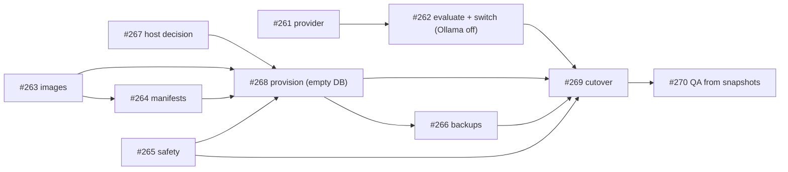

# Hosting Plan — Signal Sports off the owner's machine

**Status: PROPOSAL under owner review (2026-10-13).** Nothing in this document is implemented
yet. It is the plan for milestone 13, *"Off the owner's machine — hosted model, backend and
frontend"* (issues #261–#270), written for the owner and for a reviewer with no conversation
history. When the plan is implemented, the living contract becomes `docs/DEPLOYMENT.md`
(created by #263) and this file is retired.

All measurements were taken on 2026-10-12/13 from the local corpus (read-only) and the running
processes. External prices and limits were checked in October 2026; the sources are listed at
the end.

---

## 0. TL;DR

- **Everything moves off the owner's PC.** The LLM becomes a hosted API on a free tier. The
  API, the scheduler worker and the frontend move to **one small VM running k3s**, reached
  **privately over Tailscale**, exactly as the phone reaches the PC today.
- **Cost: about €6–6.50 a month** (≈ $7–7.50). The VM is the only paid item. $0 alternatives
  exist (§5.2), with real trade-offs.
- **Order:** take the LLM off the PC first, because that is immediate relief and needs no host.
  Then come the host decision, the images, manifests and safety switches, provisioning,
  backups, the cutover, and the QA workflow.
- **What the owner decides** (§12): the host, the runtime (k3s or Compose), the model after the
  evaluation, the off-host backup target, and when Telegram comes back.

---

## 1. Why this is the top priority

1. **The owner's PC is too weak to keep running the product.** The heaviest part is the local
   LLM: Ollama running `qwen2.5:3b-instruct` on the CPU. A call takes about 11 s, and the
   ~2 GB model is loaded back into RAM for every burst of calls.
2. **The product only works while the PC is on and someone has started every process.** The
   `scheduler_cycles` history shows the worker absent from 07-24 to 07-31, from 07-31 to
   09-15, from 09-20 to 10-08 and from 10-08 to 10-10: about 73 of 88 days. Part of that was
   deliberate (a frozen corpus for measurement), but the 09-20 stop went unnoticed for weeks.
   On 2026-10-12 the worker ran, but the API and Vite did not, so the app was unreachable from
   the phone.
3. **The future deployment.** Containers, manifests and a host are the same work whether the
   motive is offloading the PC now or deploying for real later.

**Goal:** the PC can stay off for a week while ingestion, the feed (on the phone), results and
push keep working, at a near-zero monthly cost.

---

## 2. The system in one page (for a reader without history)

Signal Sports is a personalized, Hebrew-first sports news feed with a single real user, the
owner. Full orientation is in `docs/CURRENT_PROJECT_STATE.md`.

| Part | What it is | Today |
|---|---|---|
| API | FastAPI (`uvicorn app.main:app`): auth, feed, results, ops console endpoints | on the PC, started by hand |
| Worker | `python -m app.worker`: every 5 minutes it fetches the sources, classifies, clusters, plans push, and syncs results. A durable DB lease guarantees one cycle at a time | on the PC, `scripts/worker.ps1` |
| Corpus | SQLite file `backend/data/signal_sports.db`. **Not in git, cannot be recreated.** The human ratings behind every quality gate reference its article ids | on the PC |
| Frontend | React + Vite, Hebrew/RTL. In production it is static files | Vite dev server on the PC |
| LLM | Optional classification overlay for ambiguous articles; the rules fallback always works | Ollama on the PC |
| Push | Telegram bot to the owner's private chat; at most once per story | built, currently off |
| Results | Game results from TheSportsDB (free key), synced by the worker | on the PC |
| Access | Tailscale Serve (HTTPS) → Vite on the PC | phone works only while the PC is on |

---

## 3. Measured requirements

| Quantity | Value | How measured |
|---|---|---|
| LLM calls | **35–46 per day** (at most 4 per 5-minute cycle) | `ingestion_runs.metrics.llm_attempts`, 2026-10-10 to 10-12 |
| Tokens per LLM call | ≈ **1,300**: system prompt ≈ 1,100 (4,001 chars), Hebrew headline and subtitle ≈ 100–250, output ≈ 70 | `prompt.py` plus Ollama's `eval_count` |
| Tokens per day | ≈ **60K** | the two rows above |
| New articles | ≈ 145 per day | corpus |
| Cycle duration | median **3 s**, p95 **37 s**, max 71 s (the long ones include LLM calls) | `scheduler_cycles`, 686 cycles |
| Worker RAM | ≈ **150 MB** | process working set |
| DB size | **37 MB** (+4 MB WAL), ≈ 13 KB per article → ≈ 0.7 GB per year | file size / article count |
| Frontend build | **1.1 MB** | `frontend/dist` |
| Network | outbound HTTPS only: news sites, LLM API, TheSportsDB, Telegram. Inbound: the owner's phone and PC | code |
| Users | 1 real user (plus credential-less demo profiles) | DB |

The load is tiny. Every design choice below follows from that.

---

## 4. Constraints and invariants (non-negotiable)

1. **One corpus, one writer.** Exactly one worker anywhere. If the PC and a host both ran
   workers, two corpora would diverge, and article ids, census ratings and gates all assume a
   single corpus. After the cutover the PC never runs a worker again.
2. **The corpus is never reset or blanket-reprocessed.** Backups use the SQLite backup API,
   which is safe in WAL mode. Anything destructive runs on a copy.
3. **SQLite needs a local disk.** The API and the worker share one file in WAL mode, so they
   must use the same volume on the same machine. No NFS, no network filesystem.
4. **No secrets in git, images, issues or chat.** Personal values such as hostnames, tailnet
   names and IPs are never committed. The repo is public.
5. **Private by default.** Signup is always open today (there is no switch), and durable abuse
   protection (#200) does not exist yet. So the deployment is reachable only through Tailscale.
6. **The LLM is optional.** If a provider disappears, classification falls back to rules and
   the product keeps working.
7. **Cost.** The model must cost close to nothing; a small fixed hosting cost is acceptable.
8. **Owner preference.** The owner uses OpenShift at work, so the design is pods, Deployments
   and manifests that also run on OpenShift.

---

## 5. Options considered

### 5.1 Where the LLM runs

All limits are official, checked October 2026, except where noted.

| Option | Free limit | Our share | Verdict |
|---|---|---|---|
| **Groq** | per model: 1,000 req/day, 200K tokens/day, 30 RPM, 8K TPM. Models `openai/gpt-oss-120b`, `openai/gpt-oss-20b`, `qwen/qwen3.8-27b`. No card | ~5% of requests, ~30% of tokens | **Primary.** Fast, OpenAI-compatible. Llama models are no longer on the free tier |
| **Cloudflare Workers AI** | 10,000 neurons/day | gpt-oss-120b ≈ 2,100/day; Qwen3-30B ≈ 370/day | **Fallback.** A large, stable provider. OpenAI-compatible endpoint |
| Cerebras | 1M tokens/day, 5 RPM per model | ~6% | Fine on normal days; catch-up bursts would be throttled |
| OpenRouter free models | 50 req/day (1,000 after a one-time $10 purchase), 20 RPM | ~90% | Borderline on busy days |
| Gemini (provider already in the code) | free ≈ 20 req/day (measured; Google no longer publishes the number) | >100% | Free tier ✗. **Paid Flash-Lite ≈ $0.25/month**, no code change. It is the cheap last resort |
| Ollama on a hosted VM | — | — | ✗. It needs a much larger VM, and it is the load we are trying to remove |

**Decision embedded in #261:** implement one **OpenAI-compatible provider**, so switching
between Groq, Cloudflare, Cerebras and OpenRouter is a configuration change. Free tiers do
change: Oracle halved its free ARM tier in June 2026, Groq dropped Llama from its free tier,
and Google stopped publishing Gemini's free limits. Only public headlines are sent to the LLM,
never user data.

### 5.2 Where the stack runs

| Option | Cost/month | Pods? | Fit and risks | Verdict |
|---|---|---|---|---|
| **Red Hat Developer Sandbox** (free OpenShift) | $0 | ✅ | A 30-day trial, renewable by export and import. **Pods are deleted after 12 consecutive hours and not restarted.** The 5-minute worker cannot live there | **Test bench only** (#264) |
| Managed OpenShift (ROSA, ARO, Dedicated) | priced for companies | ✅ | Far beyond this project's size | ✗ |
| **Hetzner CAX11** + k3s | **€5.99**, plus up to €0.50 for IPv4 | ✅ k3s | 2 ARM vCPU, 4 GB RAM, 40 GB disk, 20 TB traffic, EU (Germany/Finland). Stable, with room for k3s. Prices rose twice in 2026 (€3.29 → €4.49 → €5.99) | **Recommended** |
| Oracle Cloud Always Free + k3s, or OKE Basic (free control plane) | $0 (a card for PAYG) | ✅ | 2 OCPU / 12 GB on free-tier accounts since 2026-06-15; 4/24 is reportedly kept on PAYG. **Idle instances are reclaimed**: 95th-percentile CPU, network and memory all under 20% over 7 days, and our load is that light. Capacity errors are common; home region only | $0 alternative, with risk |
| Google Cloud e2-micro + Docker Compose | $0 (a billing account with a card) | ❌, k3s doesn't fit | 1 GB RAM, 0.25 vCPU sustained (bursts to 2), 30 GB disk, 1 GB egress/month, US regions. Enough without Ollama with a swap file, but CPU-tight | Minimal $0 alternative |
| Fly.io | ≈ $3.85 (a 512 MB machine and a 1 GB volume); no free tier for new orgs | ❌ PaaS | Easy, always on | Not chosen: no pods |
| Render, Railway, Northflank | — | — | Not evaluated in depth. Typical free-tier limits are sleeping services, missing volumes, or "for testing" quotas | — |
| Keep the PC + autostart (former #248) | $0 | — | It contradicts the goal | Closed as superseded |

### 5.3 How it is reached

- **Recommended: private via Tailscale.** Tailscale runs on the VM, and Tailscale Serve
  provides HTTPS for the VM's tailnet name. The VM has **no public inbound ports**: Tailscale
  needs outbound connectivity only, and SSH goes through Tailscale. The Personal plan is free:
  6 users and unlimited user devices.
- **Public URL:** possible later, but #200 (signup and login abuse protection, account
  recovery) and #196 (unifying the origin lists) must land first. Not part of this plan.

### 5.4 Database

**SQLite stays.** It is 37 MB, with one machine and one writer process at a time (the lease).
Postgres would mean running another service and changing the engine for no gain. #198 states
explicitly that the engine must not change "purely to swap technology".

---

## 6. Target architecture

```
Phone / PC ──Tailscale (private; HTTPS via Tailscale Serve)──►  ONE VM (Hetzner CAX11, k3s)
                                                                ├─ pod "web"      nginx (unprivileged): React build + /api proxy
                                                                ├─ pod "backend"  container "api"    (FastAPI, no --reload)
                                                                │                 container "worker" (5-min cycles)
                                                                │                 └─ shared PVC (local disk): SQLite corpus
                                                                └─ CronJob        nightly backup → encrypted off-host copy
Worker calls out (all free): Groq LLM API · news sites · TheSportsDB · Telegram Bot API
GitHub Actions builds multi-arch images → GHCR (public packages) → the VM pulls them
OpenShift Developer Sandbox (free) = test bench for the manifests, never production
```

### 6.1 What runs where, how much, and why

| Component | Runs on | Size / load | Cost | Why there |
|---|---|---|---|---|
| LLM classification | Groq API; model chosen in #262 | 45 calls, 60K tokens/day | $0 | Removes the heaviest load. About 1 s per call instead of 11 s, with a much bigger model. Cloudflare is a one-line fallback |
| API | container `api` in pod `backend` | ~150 MB | in VM | It must sit next to the SQLite file |
| Worker | container `worker`, same pod | ~150–250 MB; cycles of 3–40 s every 5 min | in VM | It runs 24/7. Same pod because both processes open the same SQLite file. `replicas: 1` with a `Recreate` rollout means never two writers |
| Corpus | PVC on the VM's local disk (k3s `local-path`) | 37 MB, +0.7 GB/year | in VM | No DB server needed, and WAL requires a local disk |
| Frontend | pod `web` | 1.1 MB static, ~10 MB RAM | in VM | Built once. nginx proxies `/api`, so the browser sees one origin: no CORS or CSRF changes, and cookies just work |
| Kubernetes | k3s, single node | ~0.5–0.7 GB RAM | $0 | Pods, Deployments and Services, like OpenShift. The same manifests run on OpenShift through an overlay |
| Access + TLS | Tailscale + Tailscale Serve on the VM | — | $0 | Private, no public ports, the phone flow unchanged |
| Backups | k3s CronJob running `scripts/backup_db.py`: 14 daily + 4 weekly kept locally, plus an encrypted off-host copy | ~40 MB per copy | $0 | The corpus is irreplaceable, and a copy on the same disk does not count |
| Images + CI | GitHub Actions → GHCR | ~150 MB backend, ~25 MB web | $0 | Reproducible deploys; arm64 for the ARM VM |
| External data | news sites, TheSportsDB, Telegram | outbound HTTPS | $0 | Unchanged |
| The VM | Hetzner CAX11 | ~1.4 GB of 4 GB RAM, ~5 GB of 40 GB disk, ~5–10% CPU | **€5.99–6.49** | The only paid item |
| Owner's PC | nothing permanent | — | $0 | Coding, the census rating page (local JSON), pulling read-only snapshots for QA (#270) |

### 6.2 VM resource budget (4 GB)

| Item | RAM |
|---|---|
| OS + Tailscale | ~0.35 GB |
| k3s (server + Traefik) | ~0.6 GB |
| api | ~0.15 GB |
| worker (peak, during feed builds) | ~0.25 GB |
| web (nginx) | ~0.01 GB |
| backup job (transient) | ~0.1 GB |
| **Total** | **≈ 1.4 GB, so about 65% free** |

Disk: about 5 GB of 40 (DB, backups, images, k3s). CPU: about 5–10% on average across 2 vCPUs.

### 6.3 Monthly cost

| Line | Recommended | $0 variant |
|---|---|---|
| Compute | Hetzner €5.99 + up to €0.50 IPv4 | Oracle Always Free or GCP e2-micro |
| LLM | Groq free | Groq free |
| Everything else (Tailscale, GHCR, Actions, R2, Telegram, TheSportsDB) | $0 | $0 |
| **Total** | **≈ €6–6.50** | **$0**, with the risks in §5.2 |
| If the LLM free tiers vanish | + ≈ $0.25 (Gemini Flash-Lite, paid) | same |

---

## 7. Work breakdown — milestone 13

| # | Issue | Delivers | Owner action | Depends on |
|---|---|---|---|---|
| 1 | **#261** OpenAI-compatible LLM provider | `CLASSIFICATION_PROVIDER=openai_compat`, with base URL, key and model in env. Same failure taxonomy as #217. A 429 falls back to rules with no retry loop. Reasoning effort is set low | — | — |
| 2 | **#262** Evaluate, then switch | A read-only run of 1–2 candidate models over census-rated articles, judged by **decisions against the owner's ratings**. Then the switch, and Ollama stops | create the Groq key; approve the switch | #261 |
| 3 | **#267** Host decision | The option chosen from §5.2, the runtime (k3s or Compose), private access | **decide**; create accounts and billing | — |
| 4 | **#263** Containerize | `.dockerignore` (no `.env`, no `data/`); a backend image used for both API and worker; a web image (nginx, same-origin); `deploy/compose.yaml`; CI pushing multi-arch images to GHCR; `docs/DEPLOYMENT.md` | — | (#198's lock file, if ready) |
| 5 | **#264** k8s/OpenShift manifests | Kustomize base: one backend pod with 2 containers on a ReadWriteOnce PVC with `Recreate`; a web pod; Services; Ingress; a Secret template. Overlays for k3s and OpenShift (Route, arbitrary UID). Validated on the Sandbox | Sandbox account | #263 |
| 6 | **#265** Hosted-mode safety | `AUTH_SIGNUP_ENABLED=false` on the host; `DEPLOY_ENV=hosted` refuses dangerous dev flags | — | — |
| 7 | **#268** Provision | The VM, Tailscale, k3s; no public ports; hosted settings in Secrets; the stack deployed with an **empty DB** and **`SCHEDULER_ENABLED=false`** | accounts, Tailscale auth key | #267, #263, #264, #265 |
| 8 | **#266** Backups | A nightly WAL-safe backup, an encrypted off-host copy, a rehearsed restore, visible status | choose R2 or pull-to-PC | #268 |
| 9 | **#269** Cutover | Freeze the PC → snapshot → copy → verify hash and counts → start the worker on the host → phone check. **Exit: the PC stays off for 48 h** | runs it | #268, #265, #266, #262 |
| 10 | **#270** QA without a local stack | Pulled read-only snapshots for the gate and census tools; writes such as reviewed corrections run on the host only; docs and skills updated | — | #269, #266 |

### 7.1 Sequence



In words:

- **Immediately and in parallel:** #261 (then #262), #263, #265, and the owner's decision in
  #267.
- **After those:** #264, then #268, then #266.
- **Then:** #269.
- **Finally:** #270.

The relief for the PC arrives with #262, before any hosting exists.

---

## 8. Cutover and rollback (summary of #269)

1. **Freeze.** Stop the local worker, API and Vite. Take a snapshot with `backup_db.py`, and
   record per-table counts and the sha256.
2. **Copy** the snapshot to the host volume over Tailscale. Verify the sha256,
   `PRAGMA integrity_check` and the counts.
3. **Start the worker last** (`SCHEDULER_ENABLED=true`). Verify the scheduler health, the first
   cycle, the feed on the phone, the results, and the LLM metrics.
4. **Telegram,** if wanted: run the #251 preflight on the host, then enable.
5. **Retire the PC runtime.** The frozen snapshot stays read-only as the rollback point.
6. **Rollback:** stop the hosted worker, back up on the host, copy the backup to the PC, and
   run locally. The one-writer rule applies in reverse.

---

## 9. Security model

- **No public inbound ports.** Access is only through Tailscale. Never use `tailscale funnel`.
- **Hosted settings:**
  - `DEPLOY_ENV=hosted`, `AUTH_COOKIE_SECURE=true`, `AUTH_SIGNUP_ENABLED=false`
  - `CSRF_ALLOWED_ORIGINS` set to the tailnet HTTPS origin
  - every `ALLOW_*` dev flag off, and refused at startup (#265)
- **Secrets** (Telegram token, LLM key, admin bootstrap) live in Kubernetes Secrets or an
  untracked env file. Never in images: `.dockerignore` excludes `.env` and `data/`. Never in
  git or issues.
- **Images** run as non-root, OpenShift-compatible (arbitrary UID).
- **Backups** contain account emails and password hashes. Off-host copies are encrypted, and
  the key is not on the host.
- **Data sent to third parties:** the LLM receives public headlines and subtitles only.
  Free-tier providers may use that content.

---

## 10. Operations after the cutover

| Task | How |
|---|---|
| Deploy a change | Merge to `main` → CI builds `:<sha>` → `kubectl set image` (or `apply -k` with the tag). Manual at first; automating it later is an option |
| Roll back | Re-apply the previous image tag. Restore data only for data problems (§8) |
| Is it alive? | The freshness line in the feed (#249), the pilot report (#252), backup status (#266), `kubectl get pods` |
| Logs | `kubectl logs` for the api, worker and web containers |
| Secrets | rotate in the Secret, then restart the pod |
| QA and corrections | read on pulled snapshots; write on the host only, after a backup (#270) |

**Proposed but not filed:** a dead-man's-switch alert, so the owner hears about a stopped
worker without opening the app. For example, the worker pings a free healthchecks.io check
every cycle, and missing pings send an email. It is outbound-only, so it works with a private
deployment.

---

## 11. Risks and mitigations

| Risk | Mitigation |
|---|---|
| The free LLM tier changes or ends | The OpenAI-compatible provider makes switching an env change (Groq → Cloudflare → Cerebras). Rules fallback. Paid Gemini ≈ $0.25/month |
| The new model classifies worse | #262 compares decisions against human ratings before the switch. The N05 gate. Guardrails and semantic event evidence stay in place |
| Two writers (split brain) | The one-writer rule. `SCHEDULER_ENABLED=false` on the host until the cutover. The PC never runs a worker after it |
| VM disk loss, or the host disappears | Nightly encrypted off-host backups and a rehearsed restore. Portable images and manifests |
| Accidental public exposure | No public ports, signup closed, dangerous flags refused at startup |
| SQLite corruption on network storage | Local-path volume only. Documented as a hard rule |
| Hetzner raises prices again (3 times in 2026) | Same images and manifests on Oracle or GCP |
| Oracle reclaims an "idle" free VM (if Oracle is chosen) | PAYG account, or choose Hetzner |
| k3s is more machinery than one node needs | The same images run under Compose (#263) |
| ARM incompatibility in a Python wheel | The multi-arch CI build catches it before any deploy |
| Secrets leak | `.dockerignore`, Kubernetes Secrets, no values in the repo or issues |

---

## 12. Open decisions for the owner

- [ ] **Host** (#267): Hetzner (recommended), Oracle ($0, with risk), GCP e2-micro ($0, minimal), or other
- [ ] **Runtime:** k3s (pods, recommended for the OpenShift workflow) or Docker Compose (simpler)
- [ ] **Model** after the #262 evaluation: `gpt-oss-120b` or `qwen3.8-27b` on Groq, or something else
- [ ] **Off-host backups** (#266): Cloudflare R2 (encrypted) or pulled to the PC
- [ ] **Telegram:** turn it back on after the cutover (#251)?
- [ ] **Dead-man's-switch alerting** (§10): file it?
- [ ] **A public URL, ever?** If so, #200 and #196 come first

---

## 13. Effect on the rest of the roadmap

- **Milestone 10 (Live Pilot)** runs on the host. #248 (local autostart) was closed as
  superseded. #251 (Telegram) and the 14-day acceptance window (#253) start after #269.
- **Milestone 11 (Census #3 and gate).** Rating happens locally from JSON at any time. Scoring
  uses a pulled snapshot after the cutover (#270).
- **Milestone 12 (Israeli-basketball recall)** is measured on snapshots; registry changes ship
  as code.

---

## 14. Questions for a reviewer

1. Given §3, is dropping local Ollama for a free hosted API sound? Is there a better free or
   cheap option for **Hebrew** sports-headline classification into strict JSON?
2. **k3s or Docker Compose** on a single 4 GB VM: is k3s worth the extra RAM and moving parts
   for the OpenShift-style workflow and portability?
3. Is **SQLite on one VM** acceptable here, or is there a concrete reason to move to Postgres
   now?
4. **API and worker as two containers in one pod**, sharing a ReadWriteOnce PVC with
   `Recreate`. Is that the right shape, or would two Deployments pinned to one node be better?
5. **Hetzner at ~€6/month vs Oracle at $0:** is the stability worth the cost, given the
   project's history of silent downtime?
6. **Backups:** is a nightly WAL-safe copy plus an encrypted off-host copy enough, or should
   continuous replication (for example Litestream) be considered at this size?
7. **Security:** anything missing for a private, Tailscale-only deployment with signup closed?
8. **Sequencing:** anything that should move earlier, especially before the cutover?

---

## 15. Sources (checked October 2026)

- Groq — [rate limits](https://console.groq.com/docs/rate-limits)
- Cloudflare Workers AI — [pricing](https://developers.cloudflare.com/workers-ai/platform/pricing/)
- Cerebras — [rate limits](https://inference-docs.cerebras.ai/support/rate-limits)
- Gemini API — [pricing](https://ai.google.dev/gemini-api/docs/pricing); free tier measured at ~20 requests/day ([DEV Community](https://dev.to/romeroyang/geminis-free-tier-measured-20-requests-a-day-and-google-no-longer-publishes-the-number-4gf2))
- OpenRouter — [free tier limits](https://klymentiev.com/blog/openrouter-free-tier)
- Red Hat Developer Sandbox — [FAQ](https://developers.redhat.com/developer-sandbox/FAQ)
- Hetzner — [price adjustment, June 2026](https://docs.hetzner.com/general/infrastructure-and-availability/price-adjustment/), [IP pricing](https://docs.hetzner.com/general/infrastructure-and-availability/ipv4-pricing/)
- Oracle — [Always Free halved (InfoQ)](https://www.infoq.com/news/2026/07/oracle-cloud-free-tier-limits/), [idle reclamation](https://terminalbytes.com/oracle-cloud-free-tier-changes-2026/), [OKE vs Hetzner math](https://bex.co/blog/2026/09/26/oracle-always-free-cut-free-tier-k8s-vs-hetzner)
- Google Cloud — [free tier 2026](https://agentdeals.dev/gcp-free-tier-2026)
- Fly.io — [pricing](https://fly.io/docs/about/pricing/)
- Tailscale — [Personal plan limits](https://costbench.com/software/business-vpn/tailscale/free-plan/)

---

## Change log

- **2026-10-13:** first version, written for the owner's review and a second opinion. Mirrors
  milestone 13 (#261–#270).
